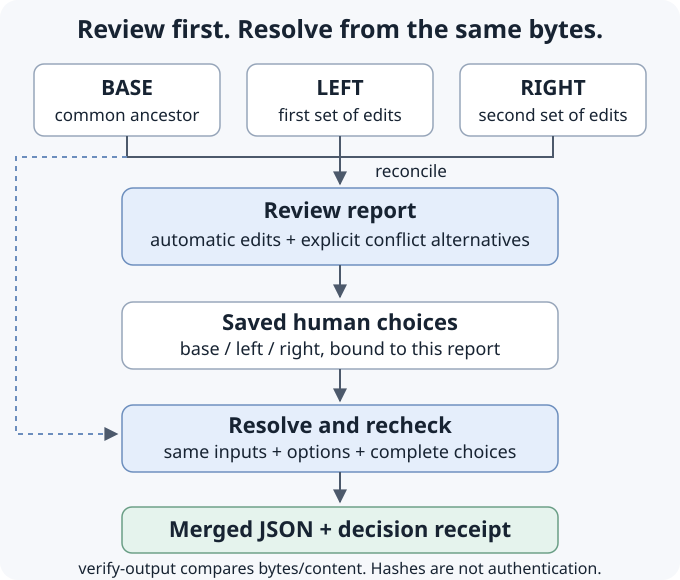

# UnitMerge

**Two branches changed the same configuration. Keep the independent edits. Make the conflicts explicit. Preserve the decision.**

UnitMerge reconciles three local JSON files: a common base and two edited versions. A person chooses `base`, `left` or `right` at each conflict. Resolution rechecks the reviewed input bytes and creates merged JSON with a decision receipt.

Python 3.11+ · No runtime dependencies in the base install · No model calls or network access · Stable V1 CLI and Python contracts



| Need | Route |
| --- | --- |
| Reconcile a local service configuration | Run the supplied example below |
| Review your own files | Generate a report and unresolved decision template |
| Understand exactly what is protected | Read the claim-to-test map and trust boundary |
| Investigate multi-worker answer merging | Read the separately labelled research results; this is not a complete UnitBoost implementation |

For a small one-off edit, ordinary text or JSON diff followed by direct editing is often sufficient. Use UnitMerge when explicit conflict choices and a receipt tied to the exact input bytes are useful. It does not establish that your configuration is correct.

## Try the supplied configuration

From a source checkout, with [uv](https://docs.astral.sh/uv/) installed, use a directory without `review.json`, `merged.json` or `merged.json.receipt.json`:

```sh
uv venv
uv pip install .
.venv/bin/unitmerge --version
.venv/bin/unitmerge reconcile examples/config-base.json examples/config-left.json examples/config-right.json --report review.json
.venv/bin/unitmerge review review.json
.venv/bin/unitmerge resolve review.json --base examples/config-base.json --left examples/config-left.json --right examples/config-right.json --decisions examples/config-decisions.json --output merged.json
.venv/bin/unitmerge verify-output merged.json --receipt merged.json.receipt.json
```

Version prints `unitmerge 1.1.0`. Reconciliation reports `REQUIRES_REVIEW`: both sides changed `/logging/level`. Creating a review returns exit 0 even when choices are needed. The supplied decision chooses `right`; resolution reports `MATERIALIZED` and verification prints:

```json
{"authenticated": false, "bytes_match": true, "content_match": true, "status": "MATCH"}
```

The resulting configuration has port `8080`, connect/read timeouts `10/30`, warning-level JSON logging and search/metrics features. An explicit null survives; the obsolete field is deleted. Compare every field with [config-expected.json](examples/config-expected.json). These are authored examples, not deployment advice.

## Review your own files

```sh
.venv/bin/unitmerge reconcile base.json left.json right.json --report change-review.json
.venv/bin/unitmerge review change-review.json
.venv/bin/unitmerge decisions-template change-review.json --output choices.json
```

Every conflict starts with `"take": "UNRESOLVED"`. Inspect the alternatives and choose `base`, `left` or `right`. Choosing a missing side deletes that key. Even a conflict-free report needs its bound template with an empty decision list.

```sh
.venv/bin/unitmerge preview change-review.json --base base.json --left left.json --right right.json --decisions choices.json
.venv/bin/unitmerge resolve change-review.json --base base.json --left left.json --right right.json --decisions choices.json --output change-merged.json
.venv/bin/unitmerge verify-output change-merged.json --receipt change-merged.json.receipt.json
```

`preview` writes no files. `READY` returns exit 0; `NEEDS_DECISIONS` or `SCHEMA_REJECTED` returns exit 1. It reports pending paths or at most 16 schema path/keyword diagnostics, without instance values. Invalid input, stale reviews and unavailable schema support return exit 2. `READY` confirms the choices pass the resolver at that moment; it does not establish application correctness. [Preview contract](docs/USAGE.md#read-only-resolution-preview).

Review and resolution may run in separate processes. Inputs must remain byte-for-byte unchanged, including whitespace. Use new output names on each run. Reports contain configuration values and should remain as private as their inputs.

## Add a schema or keyed arrays

Install `uv pip install '.[schema]'`, then supply `--schema service-schema.json` to reconciliation, preview and resolution. Draft 2020-12 validation runs locally: only references inside the supplied document are supported. External references, `$id` resources and other dialects are refused. Exact schema bytes bind to the review; `format` is informational.

Schema keywords are interpreted at **schema locations**, not in ordinary instance data. A value such as `{"$ref":"a-document-label"}` inside `const` is data; an actual external `$ref` in a subschema is refused. [Schema bounds](docs/USAGE.md#optional-local-json-schema).

Arrays are atomic by default. To merge an array of objects by identity, pass a policy such as `{"/routes":"id"}` using `--array-policy policy.json` to both commands. IDs must be unique nonempty strings. Independent IDs combine; competing edits to one ID require a whole-entry decision. Results sort by ID: **keep order-sensitive arrays atomic**. [Keyed-array behavior](docs/USAGE.md#optional-keyed-arrays).

## A claim is useful only if it has a counterexample test

| Claim | What tries to break it | Remaining limit |
| --- | --- | --- |
| Output creation is private on POSIX | [Permissive-umask tests](tests/test_output_integrity.py) | Windows ACLs and directory ancestry are not established by mode 0600 |
| Catchable failures attempt cleanup of every created output | [Write, close, interruption and unlink faults](tests/test_output_integrity.py) | Removal denial can leave files; cleanup is not a crash-atomic transaction |
| Cleanup preserves the original failure | [Descriptor-construction and secondary-cleanup failures](tests/test_descriptor_cleanup.py) | A filesystem can refuse removal; the original error still propagates |
| Literal JSON is not mistaken for schema instructions | [Schema-location tests](tests/test_schema_locations.py) | Local schemas remain trusted for computational cost |
| A receipt detects changed supplied bytes | `verify-output` | A replaced, internally consistent output/receipt pair can pass |

See [validation checks and their limits](docs/VALIDATION.md). A test's presence is not a passing execution: inspect checks for the exact commit being considered.

## Use the Python API

```python
from pathlib import Path
from unitmerge.reconcile import reconcile, resolve

inputs = tuple(Path(f"examples/config-{side}.json").read_bytes()
               for side in ("base", "left", "right"))
report = reconcile(*inputs)
choices = {
    "report_sha256": report["report_sha256"],
    "decisions": [{"path": "/logging/level", "take": "right"}],
}
result = resolve(report, choices, *inputs)
assert result["merged"]["service"]["port"] == 8080
```

The API returns detached JSON-compatible data and writes no files. Invalid supported inputs raise `ValueError`. [API and limits](docs/USAGE.md) · [Stable contracts](docs/STABILITY.md).

## Help and recovery

Run `unitmerge --help`, `unitmerge --version` or `unitmerge COMMAND --help`. On Windows use the environment's `Scripts/unitmerge.exe` instead of `.venv/bin/unitmerge`.

| Result | Recovery |
| --- | --- |
| Exit 1, `NEEDS_DECISIONS` | Review the pending paths and fill in their choices. |
| Exit 1, `SCHEMA_REJECTED` | Review the reported schema paths and keywords, then revise inputs or choices. |
| Exit 2, `INVALID_INPUT` | Check finite unique-key UTF-8 JSON, complete choices, supported schema and unused names. Error messages omit input contents. |
| Stale review | Reconcile current input/options, then review new choices; do not edit the receipt to bypass the mismatch. |
| Existing destination | Preserve it and use another name. Existing files and symlinks are not overwritten. |
| Exit 1, `BYTES_DIFFER` | Content matches but its byte representation changed; inspect the change. |
| Exit 1, `CONTENT_DIFFER` | Content no longer matches the supplied receipt; investigate before use. |
| Interrupted process or failed cleanup | Inspect both destinations before retrying. A machine failure or concurrent replacement can defeat cleanup. |

## What this establishes

Mechanical reconciliation is not application correctness. Optional schema validity does not prove the merged configuration works. Configuration decimals must retain their decimal value through finite-float parsing and serialization: `0.1`, `1.25` and exact integer tokens work; lossy tokens such as `9007199254740993.0` and `1e-400` are refused. `1` and `1.0` remain distinct. [Numeric identity and fixed bounds](docs/USAGE.md#three-way-configuration-reconciliation).

Hashes authenticate neither a source nor a reviewer. Output files are unencrypted. The tool provides no hostile-filesystem-race, production, security-certification or human-productivity guarantee.

### Research track: retained negative results

The earlier proposal checker remains available through `unitmerge --demo` and `unitmerge packet.json --sources source-texts.json`. A quotation containing “80” can still accompany a false proposed value of 900: byte support is not semantic support.

Checked collation ties normalized union in the supplied comparisons. The frozen SQuAD 2.0 development pilot retains 96 records: every arm scores 13/32 exact match and 0.40625 token F1, with false answers on 8/13 unanswerable questions. These are exposed rule-based development data, not holdout or model results. The complete scored [UnitBoost algorithm](https://arxiv.org/abs/2609.09815) is not implemented here. [Evaluation and failures](docs/EVALUATION.md).

## Development and release

```sh
uv run --no-project --with-requirements requirements-dev.txt ruff check --no-cache .
uv run --no-project python scripts/verify_docs.py
PYTHONPATH=src uv run --no-project --with jsonschema==4.26.0 python -m unittest discover -s tests -v
uv run --no-project python scripts/verify_release.py
```

The release gate builds an sdist, rebuilds its wheel, installs outside source, checks public docs and dependency metadata, runs installed tests with schema support, and exercises commands. Logs remain under `.release-scratch/`. Tooling installation may need network access. Qualification of one revision does not qualify later changes automatically.

[Usage](docs/USAGE.md) · [Stability](docs/STABILITY.md) · [Design](docs/DESIGN.md) · [Limitations](docs/LIMITATIONS.md) · [References](docs/REFERENCES.md) · [Releasing](docs/RELEASING.md) · [Changelog](CHANGELOG.md) · [Security](SECURITY.md) · [Contributing](CONTRIBUTING.md)

Original code is [MIT licensed](LICENSE). Dataset-derived pilot records retain the applicable CC BY-SA 4.0 attribution and terms in [NOTICE](NOTICE).

Personal research and development by Jason Lovell, independent of any employer or client; no endorsement is implied.
